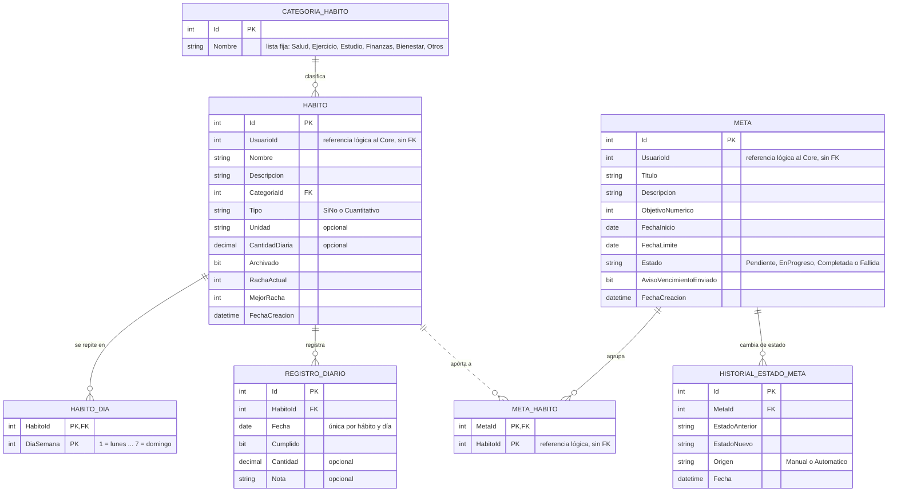
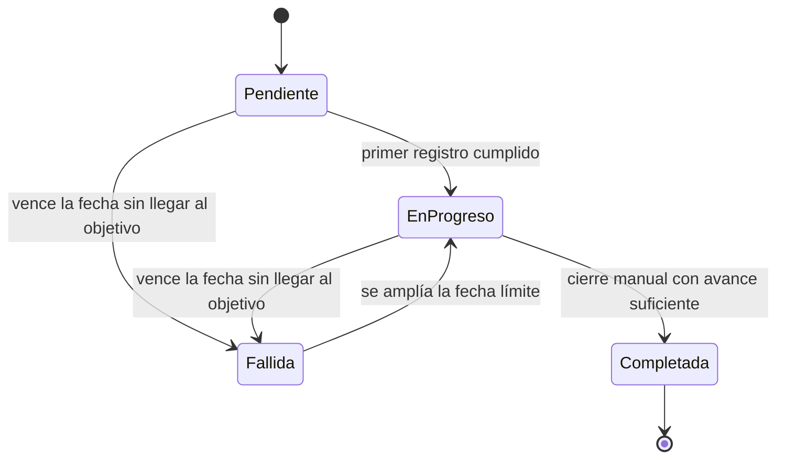

### Fronteras entre piezas

**Control de acceso y Gestión de permisos no se solapan.**

- Control de acceso responde a la pregunta *¿quién eres y qué puedes hacer?* Autentica al usuario (contraseña con hash) y valida su rol y sus permisos. Solo **guarda** los permisos que le aplican; nunca decide cuándo se conceden.
- Gestión de permisos responde a *¿qué acceso elevado pediste y en qué estado está?* Solo maneja el flujo de la solicitud (Pendiente → Aprobada → Aplicada, o Pendiente → Rechazada). No autentica ni decide si una petición pasa.
- Al aprobarse una solicitud, Gestión de permisos le pide a Control de acceso que aplique el permiso (flecha «Aplica el permiso aprobado»).
- **Quién inicia el flujo:** el usuario Estándar crea la solicitud desde el frontend, llamando directo a los endpoints de Gestión de permisos. Cuando el módulo rechaza un hábito por límite alcanzado, el frontend ofrece crear la solicitud. El navegador no se dibuja (regla del curso), por eso esta pieza tiene tres flechas de salida (a Control de acceso, Notificaciones y Auditoría) y ninguna de entrada.
- El módulo de negocio **solo habla con Control de acceso**. Por ejemplo, para saber si el usuario tiene `LIMITE_HABITOS_AMPLIADO` usa `tienePermiso`. Nunca consulta a Gestión de permisos.

**Reportes no conoce el dominio del módulo.**

- El módulo calcula sus propias métricas (cumplimiento % por semana y mes, metas por estado) con consultas GROUP BY sobre sus tablas.
- Reportes recibe las métricas **ya calculadas** y aplica los filtros por rol. Nunca sabe qué es un hábito o una meta.
- Su agregación propia como pieza del Core es sobre las solicitudes de permiso.

**Manejador de documentos se mantiene, pero marcado como no usado.**

- El curso pide las seis piezas del Core más el módulo en el diagrama, así que no se elimina.
- Se dibuja con borde discontinuo y solo registra en Auditoría. El módulo no adjunta archivos, por eso no hay flecha desde el módulo hacia esta pieza.

## 2. Responsabilidad e interfaces de cada pieza

| Pieza | Responsabilidad | Provee | Requiere |
|---|---|---|---|
| Control de acceso | Autentica, valida rol y permisos | registro, login, `/yo`, `usuarioActual()`, `tienePermiso(usuarioId, codigo)`, `aplicarPermiso(usuarioId, codigo)` | `registrarEvento` |
| Gestión de permisos | Solicitud → Aprobación | crear, aprobar y rechazar solicitud, `contarSolicitudesPorEstado()` | `aplicarPermiso`, `notificar`, `registrarEvento` |
| Manejador de documentos | Subir, listar, borrado lógico | subir, listar, descargar, eliminar | rol de Control de acceso, `registrarEvento` |
| Notificaciones | Avisos internos por evento | `notificar(destinatarioId, tipo, mensaje)`, listar avisos, marcar leído | nada |
| Reportes | Agregación genérica y filtros por rol | reportes filtrados por rol; recibe las métricas ya calculadas por los módulos | rol de Control de acceso, `contarSolicitudesPorEstado` |
| Auditoría | Quién hizo qué y cuándo | `registrarEvento(usuarioId, accion, entidad, entidadId)`, consulta filtrable | nada |
| **Módulo Rastreador de Hábitos** | Hábitos diarios, rachas y metas con progreso | endpoints de hábitos, registro diario, rachas, metas, avance y sus métricas | `usuarioActual` y `tienePermiso`, entregar métricas a Reportes, `notificar`, `registrarEvento` |

### Organización interna del módulo

Dentro de la misma pieza hay dos servicios. La dependencia va en un solo sentido.

- **Hábitos:** hábitos, frecuencia, registro diario, rachas y métricas de cumplimiento. Un `BackgroundService` rompe las rachas y lanza los avisos de racha.
- **Metas:** metas, vínculo con hábitos, máquina de estados y métricas de metas por estado. Consulta a Hábitos con `contarCumplidos(habitoIds, desde, hasta)`. Un `BackgroundService` detecta vencimientos.

## 3. Entidades del módulo

- `UsuarioId` lo entrega Control de acceso. El módulo nunca hace JOIN con las tablas del Core.
- `META_HABITO.HabitoId` es una referencia lógica (sin FK) porque Hábitos y Metas no comparten tablas. Si se elimina un hábito, Metas descarta el vínculo huérfano.
- El **avance de una meta no se guarda**: es la suma de los `RegistroDiario` con `Cumplido = 1` de sus hábitos vinculados, entre `FechaInicio` y `FechaLimite`.

## 4. Máquina de estados de Meta

- **Estado terminal:** Completada.
- **Transición prohibida:** Pendiente → Completada. Una meta debe pasar por En progreso.
- Gestión de permisos tiene su propia máquina de estados. No se mezcla ni se hereda de esta.

## 5. Reglas de negocio

1. **Registro diario:** el servidor asigna la fecha (solo hoy) y solo se permite si hoy es un día programado del hábito. Hay un solo registro por hábito y día, editable ese mismo día. En hábitos cuantitativos el usuario decide manualmente si cumplió.
2. **Límite de hábitos:** 10 activos (los archivados no cuentan), o 20 si el usuario tiene el permiso `LIMITE_HABITOS_AMPLIADO`. El módulo lo consulta con `tienePermiso`.
3. **Archivar o eliminar:** archivar conserva historial y rachas. Eliminar borra el hábito y sus registros diarios.
4. **Rachas:** cuentan días programados consecutivos cumplidos. Un `BackgroundService` rompe la racha cuando pasa un día programado sin cumplirse. Se notifica la racha rota y los hitos de 7 y 30 días.
5. **Metas:** se marca Fallida al vencer la fecha con avance menor al objetivo. Solo se puede cerrar como Completada con avance mayor o igual al objetivo. Reactivar una Fallida exige una nueva fecha límite futura.
6. **Aviso de vencimiento:** se envía una sola vez, 3 días antes, y se controla con `AvisoVencimientoEnviado`.

## 6. Revisión del diagrama

### Observaciones y decisiones

| Observación | Decisión |
|---|---|
| Reportes, siendo transversal, no debería agregar conceptos como «cumplimiento de hábitos» | **Aplicada.** El módulo calcula sus métricas y Reportes solo las recibe ya calculadas y las filtra por rol. La flecha se mantiene porque el diseño del curso dibuja al módulo alimentando Reportes. |
| Frontera difusa entre Control de acceso y Gestión de permisos | **Aplicada.** Control de acceso decide (identidad, rol, permisos). Gestión de permisos solo tramita solicitudes y le pide a Control de acceso que aplique el permiso. El módulo habla solo con Control de acceso. |
| Manejador de documentos sobra porque el módulo no lo usa | **Parcial.** Se mantiene porque el curso pide las seis piezas del Core en el diagrama. Se marca como «no lo usa este módulo» con borde discontinuo y sin flecha desde el módulo. |
| Manejador de documentos debería eliminarse porque añade ruido | **Se mantiene** (segunda revisión). Es una de las seis piezas fijas del Core que el PPTX pide dibujar. Si el profesor confirma que se puede omitir, se borra el nodo `DOC` y su flecha. |
| Control de acceso debería limitarse a autenticar y validar; la asignación de permisos debería ser solo de Gestión de permisos | **Aplicada en parte.** La descripción pasa a «Autentica, valida rol y permisos». Gestión de permisos decide cuándo se concede un permiso, pero el permiso se guarda en Control de acceso (`aplicarPermiso`), porque una pieza no puede escribir en las tablas de otra. |
| Gestión de permisos parece no tener flechas | **Sin cambio.** Tiene tres flechas de salida (a Control de acceso, Notificaciones y Auditoría). No tiene flecha de entrada porque quien inicia el flujo es el usuario desde el frontend, que no se dibuja. |

### Las seis señales de diseño malo

| # | Señal | Resultado en este diagrama |
|---|---|---|
| 1 | Una caja llamada «Utils», «Común» o «Helpers» | No hay. Cada pieza tiene una responsabilidad y un dueño. |
| 2 | Una flecha en los dos sentidos | Ninguna. Las 8 flechas no forman ciclos. |
| 3 | Un nombre con dos verbos | Todos los nombres son sustantivos. |
| 4 | Una flecha del Core hacia tu módulo | Ninguna. El Core no conoce el módulo. |
| 5 | Una flecha sin etiqueta | Las 8 flechas tienen etiqueta con su propósito. |
| 6 | La base de datos dibujada como componente | No aparece. Tampoco el frontend. |
