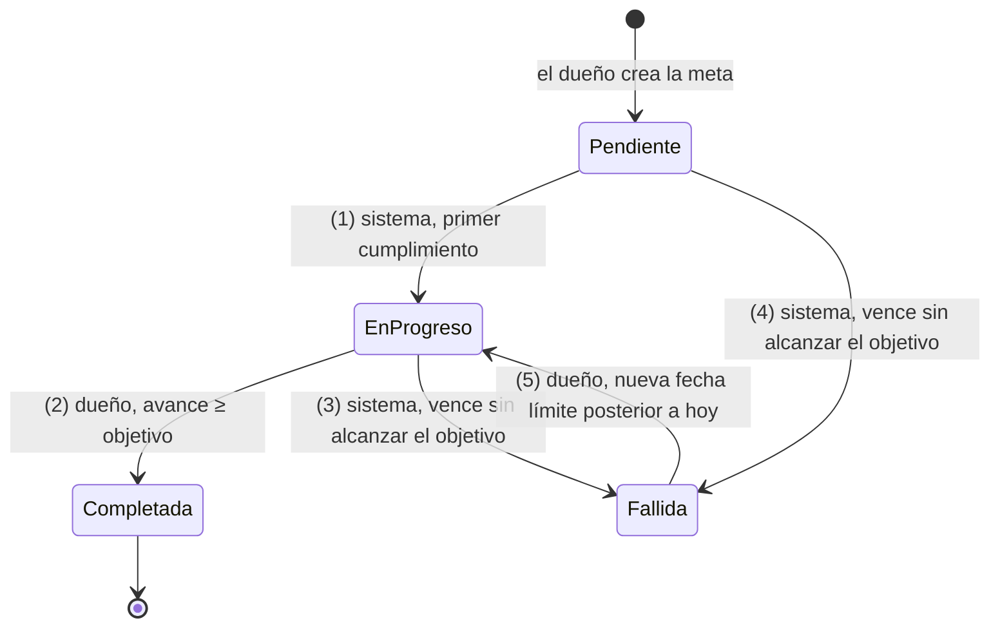

# Máquina de estados de negocio — `Meta`

Práctica 3 (RF-NEG-03, RF-NEG-04, RF-NEG-05, RF-NEG-09, RD-04). Es la máquina de
`docs/diseno-componentes-detalle.md` (sección 4) y reemplaza a la estructura declarada en la
Práctica 1. Este archivo describe exactamente lo que está implementado.

## La entidad central

Una **Meta** agrupa uno o más hábitos de un usuario y se logra al sumar un objetivo de
cumplimientos. Ejemplo: «Hacer ejercicio 20 veces antes del 30 de noviembre».

| Atributo | Para qué |
|---|---|
| `UsuarioId` | Dueño de la meta (el Id que entrega Control de acceso) |
| `Nombre` | Descripción de la meta |
| `ObjetivoCumplimientos` | Cumplimientos necesarios para lograrla (1 o más) |
| `FechaInicio` | Día en que se creó; desde ahí cuentan los cumplimientos |
| `FechaLimite` | Último día en que cuentan los cumplimientos |
| `Habitos` | Hábitos del propio usuario que aportan a la meta (tabla `Metas.MetasHabitos`) |
| **`Estado`** | Estado actual de la máquina |

El **avance** no se guarda: es la cantidad de registros diarios con `Cumplido = true` de los
hábitos de la meta entre `FechaInicio` y `FechaLimite`, ambas incluidas. Lo calcula Hábitos
(`contarCumplidos`).

## Dónde está en el código

| Qué | Archivo |
|---|---|
| Los estados, en un solo lugar (RF-NEG-03) | `src/Negocio/RastreadorHabitos.Modulo.Metas/Entities/EstadoMeta.cs` |
| Las transiciones permitidas con quién las ejecuta y su condición, las prohibidas explícitas y la resolución de cada transición, en un solo lugar (RD-04, RF-NEG-04, RF-NEG-05) | `src/Negocio/RastreadorHabitos.Modulo.Metas/Reglas/TransicionesMeta.cs` |
| Quién ejecuta una transición y los datos de su condición | `src/Negocio/RastreadorHabitos.Modulo.Metas/Reglas/ContextoTransicion.cs` |
| La entidad: solo cambia de estado por `CambiarEstado`, que pide a `TransicionesMeta` resolver la transición | `src/Negocio/RastreadorHabitos.Modulo.Metas/Entities/Meta.cs` |
| Las operaciones (crear, consultar, completar, reactivar) | `src/Negocio/RastreadorHabitos.Modulo.Metas/Services/MetasService.cs` |

La máquina es independiente de la de Gestión de permisos (RF-NEG-09): el módulo de Metas no
referencia a Gestión de permisos ni usa `EstadoSolicitud`. Cambiar los estados de una solicitud
no obliga a tocar ningún archivo de Metas.

## Estados

| Estado | Significado | Terminal |
|---|---|---|
| **Pendiente** | Estado inicial: la meta recién creada no tiene ningún cumplimiento | No |
| **En progreso** | Tiene al menos un cumplimiento y su dueño todavía no la cerró | No |
| **Completada** | Su dueño la cerró con el avance suficiente | **Sí** |
| **Fallida** | Venció la fecha límite sin alcanzar el objetivo | No: su dueño puede reactivarla |

**Estado inicial.** Toda meta nace **Pendiente** al crearla su dueño
(`POST /api/metas`), con un objetivo de 1 o más, una fecha límite que no es anterior a hoy y al
menos un hábito propio.

## Transiciones permitidas

En el mismo orden en que están declaradas en `TransicionesMeta.cs`.

| # | Desde | Hacia | Quién la ejecuta | Condición |
|---|---|---|---|---|
| 1 | Pendiente | En progreso | Sistema | La meta tiene al menos un cumplimiento (avance ≥ 1) |
| 2 | En progreso | Completada | Usuario dueño (`POST /api/metas/{id}/completar`) | El avance alcanza el objetivo (avance ≥ objetivo) |
| 3 | En progreso | Fallida | Sistema | Venció la fecha límite (hoy es posterior a la fecha límite) y el avance es menor que el objetivo |
| 4 | Pendiente | Fallida | Sistema | Venció la fecha límite (hoy es posterior a la fecha límite) y el avance es menor que el objetivo |
| 5 | Fallida | En progreso | Usuario dueño (`POST /api/metas/{id}/reactivar`) | La nueva fecha límite es posterior a hoy; al reactivar, la meta toma esa fecha límite |

Cada transición se rechaza, y el estado no cambia, si la intenta quien no la ejecuta (el dueño
no puede forzar una transición del sistema ni al revés) o si no se cumple su condición.

**Cuándo actúa el sistema.** Cada vez que se consulta una meta (`GET /api/metas`,
`GET /api/metas/{id}`), al crearla y antes de que su dueño la complete o la reactive, el sistema
calcula el avance y aplica, en el orden de la tabla, las transiciones suyas cuya condición se
cumple. Por ejemplo, una meta Pendiente con un cumplimiento cuya fecha límite ya venció pasa a
En progreso (fila 1) y enseguida a Fallida (fila 3).

## Transiciones prohibidas (RF-NEG-04)

Son todas las parejas de estados que no están en la tabla anterior. Están declaradas una por
una en `TransicionesMeta.cs`, con el mensaje que recibe quien las intenta. Intentarlas se
rechaza (`409`) y el estado no cambia.

| # | Desde | Hacia | Por qué |
|---|---|---|---|
| 1 | Pendiente | Completada | Toda meta lograda pasa por En progreso |
| 2 | En progreso | Pendiente | El avance no se deshace |
| 3 | Completada | Pendiente | Completada es terminal |
| 4 | Completada | En progreso | Completada es terminal |
| 5 | Completada | Fallida | Completada es terminal |
| 6 | Fallida | Completada | Una meta Fallida primero debe reactivarse |
| 7 | Fallida | Pendiente | Una meta reactivada vuelve a En progreso, no a Pendiente |

## Estado terminal (RF-NEG-05)

**Completada**: ninguna transición permitida parte de ese estado. `TransicionesMeta.EsTerminal`
lo deduce de la misma tabla de permitidas.

